# Fenologia do CROPGRO-Soybean por grupo de maturação para o Brasil

**Relatório técnico para apresentação: base dos dois artigos (ASD e MLCSE)**

UTFPR, Santa Helena (PR). Versão de 29/10/2026. Os resultados são da calibração final (v13), da inversão por satélite (NPE) e das simulações de produtividade (opção A, BRS 284).

> As figuras e tabelas estão em inglês, como nos artigos. As figuras ficam em `calibracao_mg/resultados/figuras_en/`.

---

## 1. Visão geral

### O problema

- O CROPGRO-Soybean (DSSAT) é rodado no Brasil com cultivares genéricas norte-americanas ou com coeficientes calibrados para uma só cultivar e um só local.
- O Brasil semeia cultivares de grupo de maturação relativa (GMR) 5 a 9,5 ao longo de cerca de 30° de latitude.
- Nenhuma estatística oficial registra o GMR e a data de semeadura que o produtor realmente usa em cada região e safra.

### O que foi feito

1. Os seis coeficientes fenológicos do modelo foram calibrados como **funções contínuas do GMR**. A calibração é bayesiana hierárquica e combina 746 termos de verossimilhança de três tipos de dado.
2. O DSSAT foi substituído por um **emulador de *gradient boosting*** durante a calibração, porque seriam necessárias centenas de milhares de avaliações.
3. Uma rede neural (**NPE**, *neural posterior estimation*) inverteu a fenologia MODIS em **GMR efetivo e data de semeadura** para 4.030 pontos-safra entre 2000 e 2024.
4. Com esses insumos, foram simulados Yp e Yw em todo o país, e a **limitação hídrica relativa Yw/Yp** foi quantificada.
5. Os resultados viraram **produtos de uso direto**: arquivos de cultivar do DSSAT por ponto, um notebook no Colab e um atlas em HTML.

### Os dois artigos

São independentes, não se citam e repetem os métodos onde preciso.

| | ASD: *Agronomy for Sustainable Development* | MLCSE: *Machine Learning for Computational Science and Engineering* |
|---|---|---|
| Título | Maturity-group-based phenology of CROPGRO-Soybean for Brazil and the effective maturity group of soybean from 2000 to 2024 | Emulator-based Bayesian calibration and amortized inference of soybean phenology across Brazil with a process-based crop model |
| Pergunta central | Quais coeficientes por GMR, que GMR o produtor semeia, quanto a água limita a produtividade e como planejar | Como calibrar e inverter um simulador caro com dados heterogêneos, diagnosticando identificabilidade |
| Ênfase | Coeficientes, validação agronômica, Paragominas, tendência do GMR, Yw/Yp, planejamento | Emulador (GB × MLP × ridge), verossimilhança hierárquica, 13 versões, comparação com o GLUE, NPE × MCMC |
| Tamanho atual | 23 páginas + suplementar | 20 páginas + suplementar |

### Fluxo do estudo

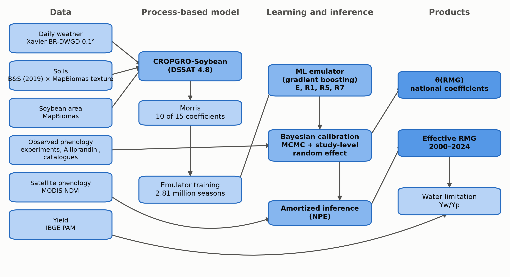

*Comentário:* o fluxo tem três blocos.
1. **Calibração.** DSSAT → emulador → MCMC com as observações fenológicas.
2. **Inversão.** A posterior calibrada gera as simulações que treinam o NPE, que é então aplicado ao MODIS.
3. **Aplicação.** O GMR efetivo e a semeadura alimentam o DSSAT para Yp/Yw, os produtos e o planejamento.

O ASD usa esse diagrama. O MLCSE usa a versão estatística da mesma estrutura, mostrada abaixo.

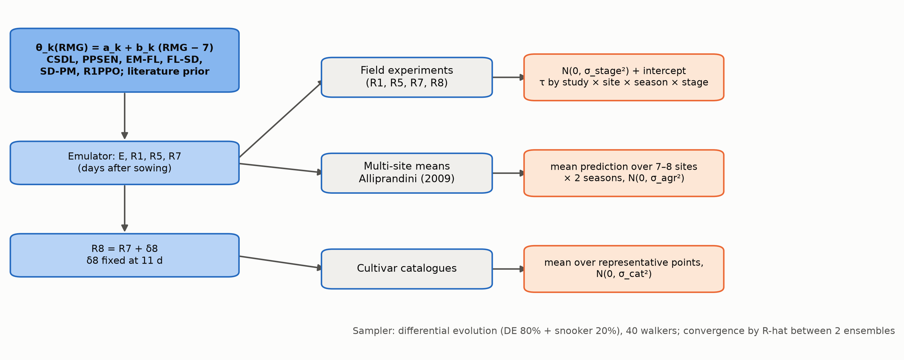

---

## 2. Área de estudo, clima, solos e produtividade observada

- **Grade:** 462 pontos de Battisti et al. (2019), com cerca de 1° de resolução. Desses, 224 pontos têm soja suficiente na máscara MapBiomas para extrair a fenologia MODIS.
- **Regiões:**
  - RS/SC;
  - PR/SP/MS;
  - GO/MG/DF e norte do MS;
  - MT/RO e Norte;
  - MATOPIBA.
- **Clima:** BR-DWGD (Xavier, 0,1°), 1980–2025, média das quatro células em torno de cada ponto.
- **Solos:** três perfis de Battisti et al. (2019), com 120, 80 e 48 mm de água disponível. Cada um foi ponderado pela fração da sua classe textural no mapa do MapBiomas, dentro da área de soja da célula.

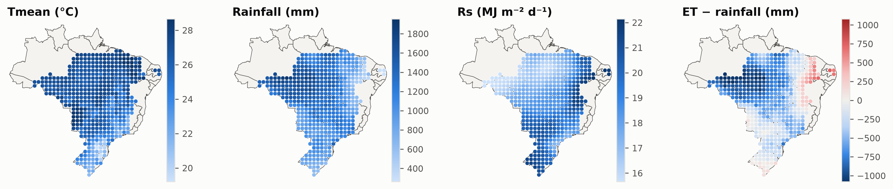

*Comentário:* a chuva e a temperatura da safra mostram o contraste que move todo o trabalho. O Centro-Oeste e o Norte têm estação chuvosa longa e regular. O Sul tem chuva mais irregular, e o MATOPIBA tem início das chuvas tardio.

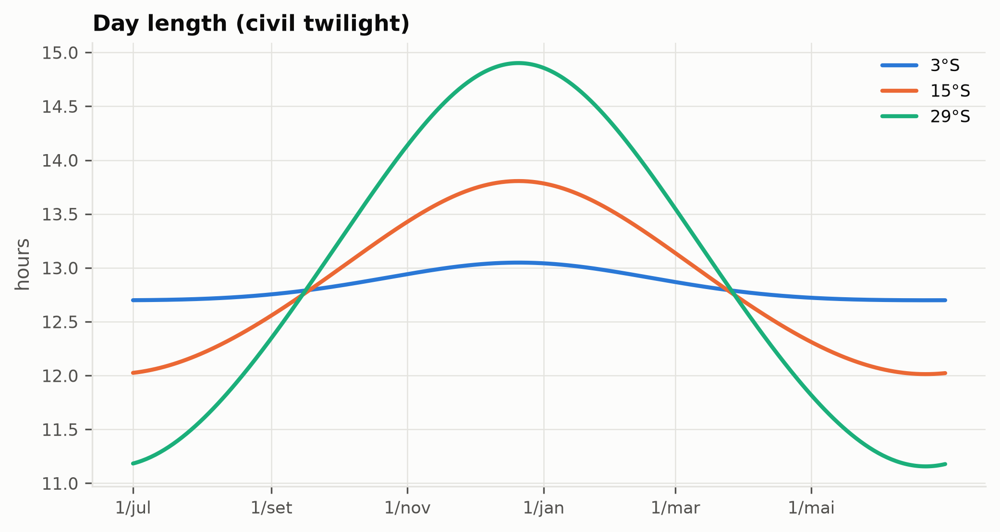

*Comentário:* o fotoperíodo é a razão física para calibrar por GMR. Perto do Equador o dia quase não varia ao longo do ano; no RS, passa de 14 h no verão. A mesma cultivar tem ciclos muito diferentes em cada latitude, e o modelo só reproduz isso com coeficientes de fotoperíodo coerentes com o GMR.

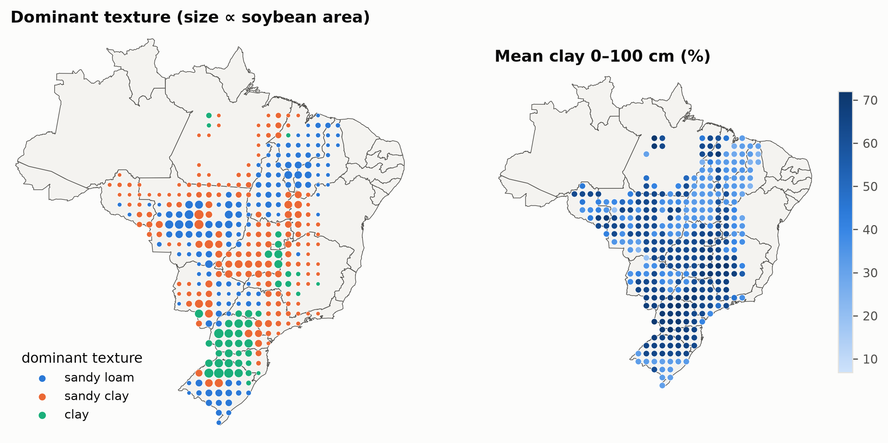

*Comentário:* o perfil franco-arenoso (48 mm) ocupa cerca de 54% da área de soja no MATOPIBA. Ocupa também 52% em MT/RO e só 19% no Sul. Portanto, a textura sozinha não explica a limitação hídrica (ver Seção 9).

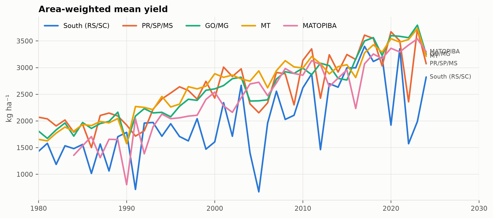

*Comentário:* a produtividade municipal do IBGE subiu de 2,52 para 3,25 t/ha entre 2001–05 e 2020–24, cerca de 39 kg/ha por ano. Esse ganho genético e de manejo **não** está no modelo, que usa uma cultivar fixa (BRS 284). Por isso o IBGE foi usado para validar a **variação entre anos**, não o nível.

### Replicação de Battisti et al. (2019)

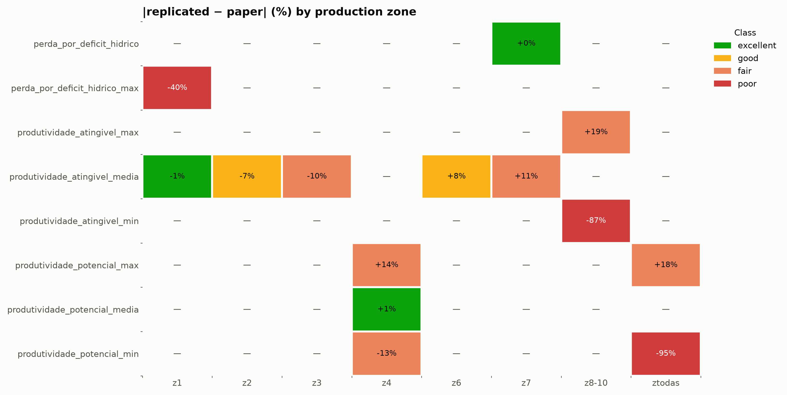

*Comentário:* antes de calibrar, a configuração de clima, solo e manejo foi checada contra o estudo de referência. As produtividades atingível e potencial foram reproduzidas por zona de produção com diferenças de ±11% e ±3%. Isso dá base para usar os coeficientes de crescimento da BRS 284 nas simulações de produtividade.

---

## 3. Observações fenológicas

| Tipo | Estádios | Registros | Modelo de erro |
|---|---|---|---|
| Experimentos de campo (8 estudos, 13 locais, 7 estados) | R1, R5, R7, R8 | 453 | Gaussiano + efeito aleatório por estudo |
| Médias multilocais (Alliprandini et al., 2009; 88 cultivares) | R1, R8 | 176 | Gaussiano |
| Catálogos de cultivares (7 fontes) | ciclo (R8) | 117 | Gaussiano |

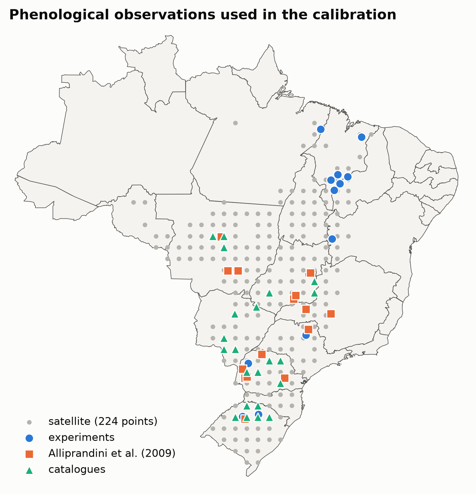

*Comentário:* nenhum experimento isolado cobre latitudes, épocas e GMRs. A calibração nacional só é possível juntando as três fontes, cada uma com sua escala de erro. Os experimentos de época de semeadura (Passo Fundo e MATOPIBA) são os que informam a sensibilidade ao fotoperíodo.

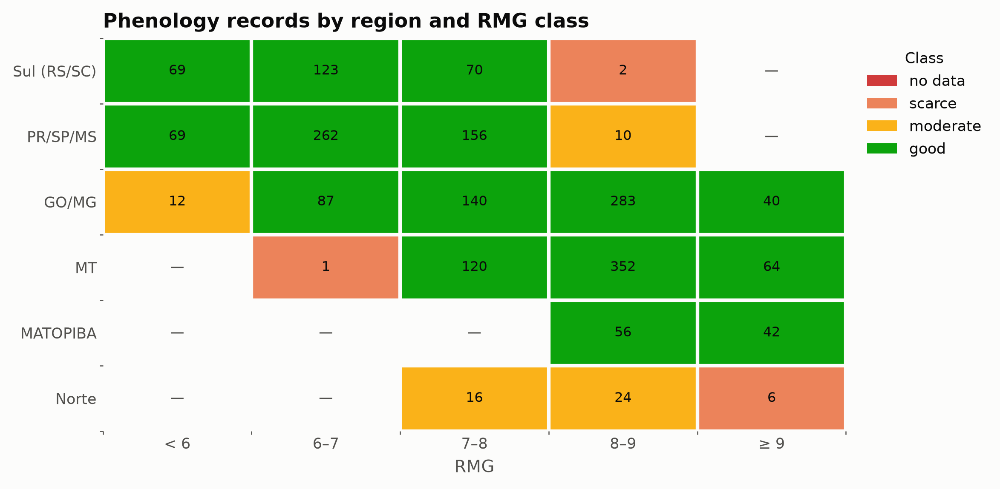

*Comentário:* a cobertura por região e GMR mostra onde os dados são mais densos e onde a calibração depende mais das médias multilocais e dos catálogos.

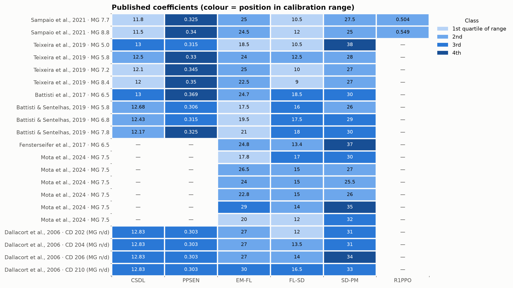

*Comentário:* as 21 calibrações publicadas de cultivares brasileiras definiram as faixas admissíveis e as *priors* de FL-SD e SD-PM. Elas variam muito entre si, mesmo dentro do mesmo GMR, o que já indica compensação entre coeficientes.

### Escolha dos coeficientes (Morris)

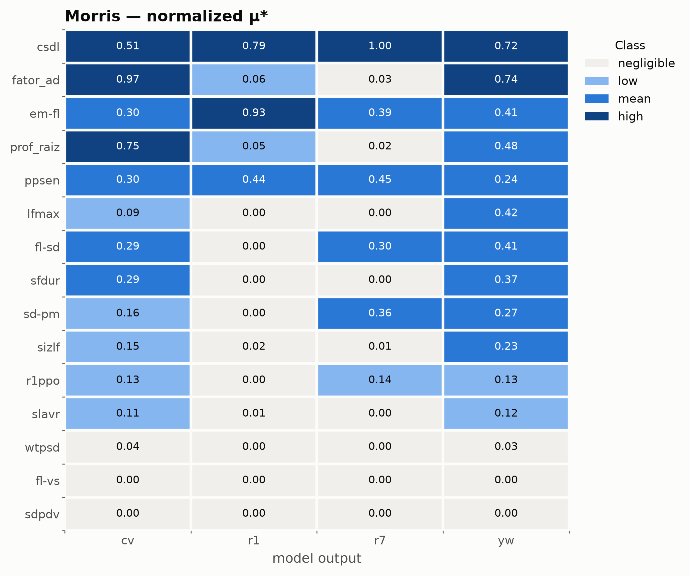

*Comentário:* uma triagem de Morris com 9.600 simulações (20 pontos × 3 épocas) selecionou 6 de 15 coeficientes:

- **CSDL**, o comprimento de dia crítico (h);
- **PPSEN**, a sensibilidade ao fotoperíodo (h⁻¹);
- **EM-FL**, **FL-SD** e **SD-PM**, as durações fototermais das fases;
- **R1PPO**, a redução do dia crítico após R1 (h).

Cada coeficiente é linear no GMR: θ = a + b·(GMR − 7).

---

## 4. Emulador do DSSAT

Uma estação simulada no DSSAT leva cerca de 2,4 s, e a MCMC precisou de 720.000 avaliações da posterior. A solução foi um emulador:

- treinado em **2,81 milhões de estações simuladas em 73 locais**, com amostragem por hipercubo latino;
- um modelo por saída (emergência, R1, R5 e R7);
- validado deixando **locais inteiros** fora do treino.

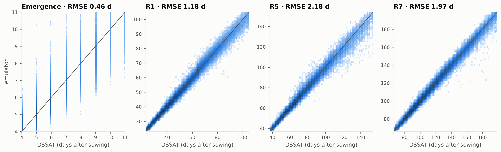

*Comentário:*
- RMSE em locais não vistos: 0,46 d (emergência), **1,19 d (R1)**, 2,20 d (R5) e **1,97 d (R7)**, com R² = 0,99.
- Esses erros são **2 a 4 vezes menores** que os erros das observações (3,3 a 8,4 d), o que justifica tratar o erro do emulador como parte do erro observacional.
- Uma estação leva cerca de 86 µs no emulador, contra 2,4 s no DSSAT: cerca de 3×10⁴ vezes mais rápido.

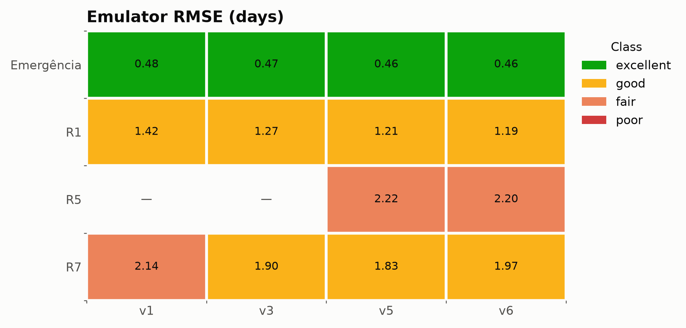

*Comentário:* passar de 47 para 73 locais (de 1,69 para 2,81 milhões de estações) reduziu o RMSE de R1 de 1,42 para 1,19 d. **Mais locais** generalizam melhor do que mais amostras por local, e é isso que importa numa calibração nacional.

**Comparação de emuladores (MLCSE).** Mesma subamostra de 400 mil estações e mesmos 5 *folds* por local:

| Emulador | RMSE R1 (d) | RMSE R7 (d) | Predição (µs/linha) |
|---|---|---|---|
| Gradient boosting (usado) | 1,27 | 2,04 | 32–35 |
| Rede neural 2×128 | **0,80** | **1,00** | 3–5 |
| Ridge | 6,06 | 9,07 | <1 |

*Comentário:*
- A rede neural é melhor e mais rápida.
- O ridge mostra que a resposta é fortemente não linear.
- Reavaliar a posterior final com a rede neural baixou a log-posterior em 86 unidades, sobretudo pelo R8 das médias multilocais, que são as observações mais precisas.
- O GB foi mantido porque toda a cadeia de resultados foi construída sobre ele. O MLP fica como melhoria para versões futuras, e isso é dito explicitamente no artigo.

---

## 5. Calibração bayesiana: o caminho até a v13

**Verossimilhança.** Nos experimentos, o resíduo é dividido em duas partes:
- um **intercepto aleatório** por estudo × local × safra × estádio (38 grupos), integrado analiticamente pela identidade de Sherman–Morrison;
- um erro por estádio.

A data de semeadura **não** entra no agrupamento, para não absorver o sinal do fotoperíodo. Catálogos e médias multilocais entram com erro gaussiano independente, comparados com a média das previsões nos locais e safras que representam.

**Amostrador.** emcee com movimentos de evolução diferencial (80%) + *snooker* (20%), em dois *ensembles* independentes de 40 caminhantes. Na v13 foram 9.000 passos e cerca de 11 h num laptop.

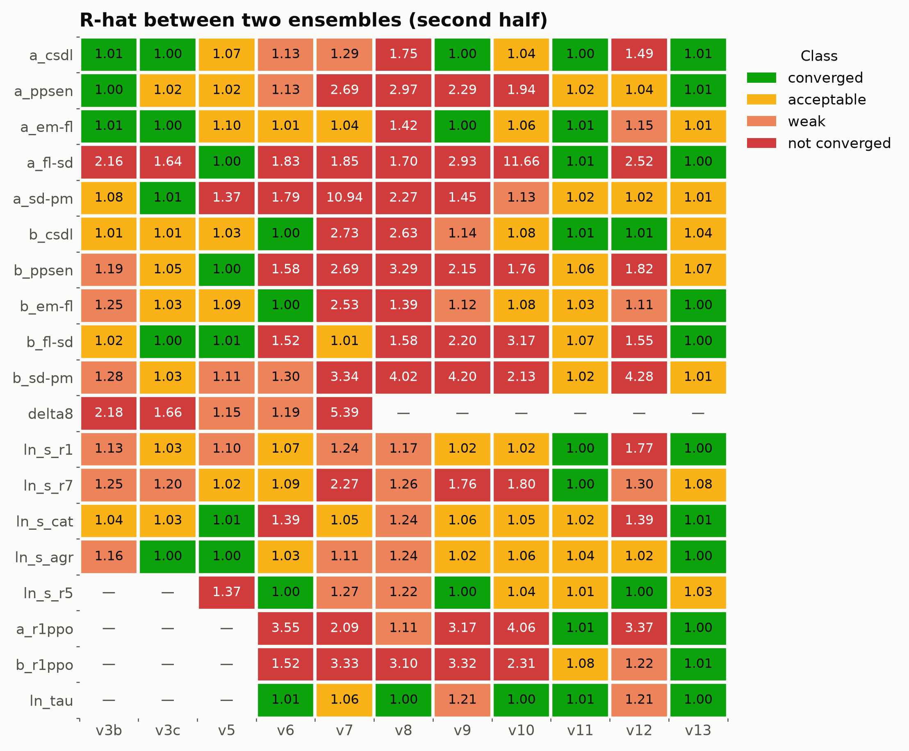

*Comentário:* foram 13 versões da posterior, cada uma motivada por um diagnóstico da anterior. Rodar **dois *ensembles* independentes** e comparar o R-hat foi o que revelou os problemas. Com uma cadeia só, nenhum deles teria aparecido.

| Problema encontrado | Sintoma | Solução |
|---|---|---|
| Crista FL-SD × δ8 (R7→R8) | Os *ensembles* convergem para FL-SD 10,8 e 16,2 (R-hat ≈ 2,2) | Incluir **70 observações de R5** que já estavam nos estudos (R-hat = 1,00) |
| Efeito aleatório absorvendo o tratamento | Com a época no agrupamento, τ = 8,4 d e R1PPO não identificável (R-hat = 3,6) | Tirar a época do agrupamento |
| Crista SD-PM × δ8 | SD-PM 26,1 × 20,8 com log-posterior igual | **Fixar δ8 = 11 d** (Paragominas é o único experimento com R7 e R8) |
| Bimodalidade R1PPO × durações reprodutivas | Um modo com R1PPO ≈ 0,55 e fases longas, outro com ≈ 0,9 e fases curtas | Decompor a log-posterior: Passo Fundo +18, catálogos +9, médias +6 a favor do modo de R1PPO alto; reiniciar os dois *ensembles* nesse modo |
| Posterior "boa" que derruba a produtividade (v11) | FL-SD e SD-PM abaixo de toda a literatura; IC ≈ 0,22 e Yp do Sul ≈ 2,3 t/ha | **Faixa fisiológica** FL-SD ≥ 10,5 e SD-PM ≥ 25 (v12/v13); IC de 0,32 a 0,52 e Yp de 3,1 a 4,2 t/ha, ao custo de cerca de 30 unidades de log-posterior |

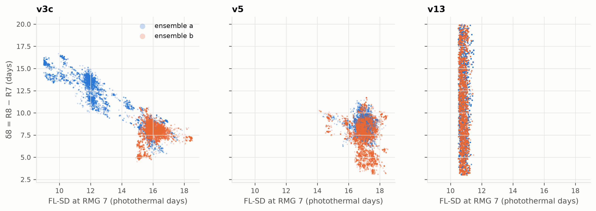

*Comentário:* a crista é o exemplo didático da não identificabilidade. Um enchimento de grão mais longo e um intervalo R7→R8 mais curto dão o mesmo R8. Uma observação num estádio intermediário (R5) valeu mais do que qualquer *prior* sobre o fim do ciclo.

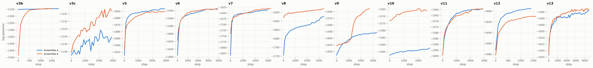

*Comentário:* as trajetórias mostram a estacionariedade da v13.
- R-hat ≤ 1,08 em todos os componentes.
- Tempo de autocorrelação τ ≈ 470 passos, o que dá ESS ≈ 760.
- As medianas dos coeficientes mudaram menos de 0,3 dia fototermal ou 0,01 h em relação aos primeiros 3.000 passos.

> **Lição metodológica principal (MLCSE):** uma posterior convergida e que ajusta melhor os dados pode estar errada quando os parâmetros alimentam processos que os dados não observam. A calibração de fenologia precisa ser checada em saídas a jusante, como a produtividade.

### Comparação com o GLUE do DSSAT

O GLUE foi reproduzido com o mesmo emulador, a mesma verossimilhança e as mesmas *priors*: sorteio uniforme independente dos 12 coeficientes, com as escalas de erro fixas.

| | GLUE 6.000 (padrão DSSAT) | GLUE 60.000 | MCMC |
|---|---|---|---|
| Tamanho efetivo da amostra | **1,0** | **1,8** | ≈ 760 |
| Melhor log-posterior | −1845 | −1797 | **−1579** |
| Tempo (h) | 0,3 | 2,9 | ≈ 11 |
| RMSE experimentos R1 / R8 (d) | 6,3 / 19,2 | 6,0 / 13,8 | 6,3 / 16,7 |
| RMSE multilocal R1 / R8 (d) | 5,9 / 1,8 | 3,5 / 4,6 | 3,2 / 1,9 |
| RMSE catálogos (d) | 8,6 | 9,8 | 8,4 |

*Comentário:*
- O GLUE **degenera** em 12 dimensões. Com 6.000 conjuntos, um único conjunto leva todo o peso, e a "incerteza" vira um ponto.
- Os coeficientes mudam com o número de sorteios: R1PPO no GMR 7 vale 1,03 h com 6.000 sorteios e 0,63 h com 60.000, contra 0,86 h na posterior.
- O melhor conjunto acerta algumas fontes e erra outras. Com 60.000 sorteios, ele ajusta melhor o R8 dos experimentos, mas erra mais que o dobro nas médias multilocais, que são as observações mais precisas.
- O GLUE não tem diagnóstico de convergência, então não revelaria os modos.

---

## 6. Coeficientes finais por GMR (v13)

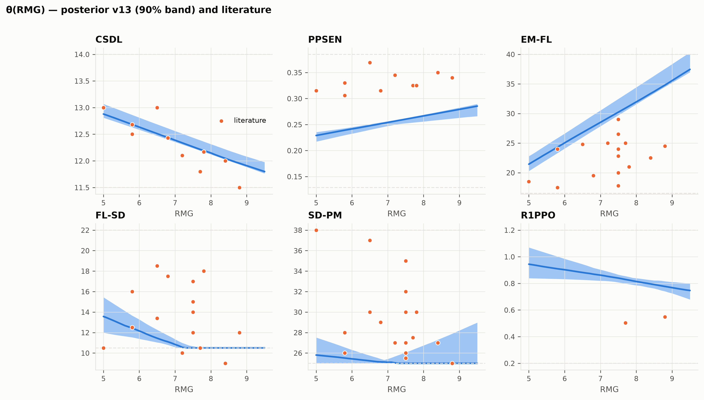

| Coeficiente | GMR 5 | GMR 6 | GMR 7 | GMR 8 | GMR 9 |
|---|---|---|---|---|---|
| CSDL (h) | 12,88 | 12,63 | 12,39 | 12,14 | 11,90 |
| PPSEN (h⁻¹) | 0,228 | 0,241 | 0,253 | 0,266 | 0,279 |
| EM-FL (dft) | 21,1 | 24,8 | 28,4 | 32,1 | 35,8 |
| FL-SD (dft) | 13,9 | 12,4 | 10,8 | 10,5 | 10,5 |
| SD-PM (dft) | 25,9 | 25,5 | 25,1 | 25,0 | 25,0 |
| R1PPO (h) | 0,948 | 0,904 | 0,860 | 0,817 | 0,773 |

dft = dias fototermais.

*Comentário:*
- **Grupos mais tardios** têm ciclo mais longo por dois mecanismos: dia crítico menor (−0,24 h por GMR), que atrasa o florescimento nos dias curtos de baixa latitude, e fase juvenil mais longa (+3,7 dft por GMR).
- **CSDL** concorda com a literatura: de 13,0 h no GMR 5 (Teixeira) a 11,5 h no GMR 8,8 (Sampaio).
- **EM-FL e PPSEN** ficam diferentes da literatura (EM-FL maior, PPSEN menor). Isso é **compensação entre CSDL/PPSEN e EM-FL**: no GMR 6,5, a calibração conjunta dá 12,51 h / 0,247 h⁻¹ / 26,6 dft, contra 13,0 / 0,369 / 24,7 da BRS 284 calibrada sequencialmente (Battisti et al., 2017). As duas combinações reproduzem o florescimento. A calibração sequencial fixa o fotoperíodo da literatura e ajusta só a duração térmica; a conjunta escolhe a partição que melhor ajusta muitas latitudes e épocas ao mesmo tempo.
- **R1PPO alto** (cerca do dobro do padrão dos ecótipos, 0,41–0,55) é necessário para reproduzir o ciclo longo das semeaduras de setembro em Passo Fundo.
- **FL-SD e SD-PM** encostam nos limites fisiológicos. Os coeficientes formam um **conjunto efetivo**, coerente com os coeficientes de crescimento da BRS 284, e não medições fisiológicas diretas.

---

## 7. Desempenho fenológico

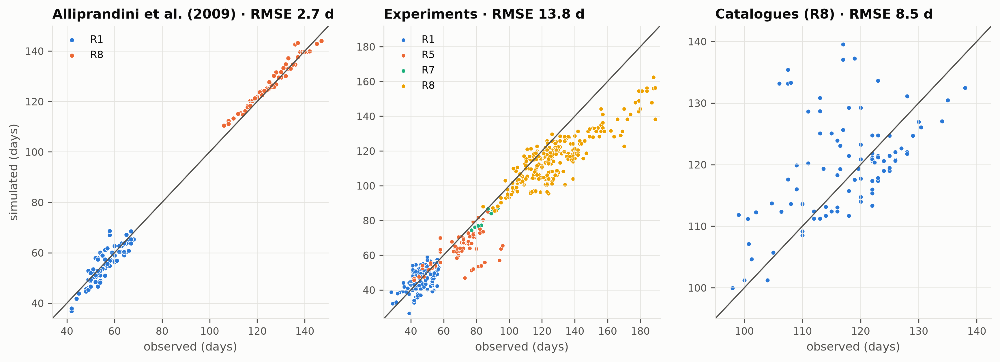

| Tipo | Estádio | n | RMSE (d) | MBE (d) | d (Willmott) | r |
|---|---|---|---|---|---|---|
| Médias multilocais | R1 | 88 | **3,2** | −0,7 | 0,93 | 0,89 |
| | R8 | 88 | **1,9** | 1,1 | 0,99 | 0,99 |
| Catálogos | ciclo | 117 | 8,4 | 2,3 | 0,72 | 0,52 |
| Experimentos | R1 | 116 | 6,3 | 0,0 | 0,74 | 0,55 |
| | R5 | 70 | 11,9 | −6,2 | 0,71 | 0,58 |
| | R7 | 8 | 3,7 | −3,2 | 0,89 | 0,94 |
| | R8 | 259 | 16,7 | −12,2 | 0,80 | 0,87 |
| | R8 sem Passo Fundo | 154 | 7,2 | −4,5 | 0,89 | 0,87 |

*Comentário:*
- As **médias multilocais** são reproduzidas com erros de 2 a 3 dias, em todo o Brasil e do GMR 5 ao 9,4.
- O erro dos **catálogos** (8,4 d) é igual à escala de erro estimada para eles: os catálogos arredondam o ciclo e fazem médias entre regiões.
- Os **experimentos** têm erro maior por dois motivos. Primeiro, as diferenças sistemáticas entre estudos (desvio do efeito de estudo de 8,3 d). Segundo, Passo Fundo (ver abaixo).

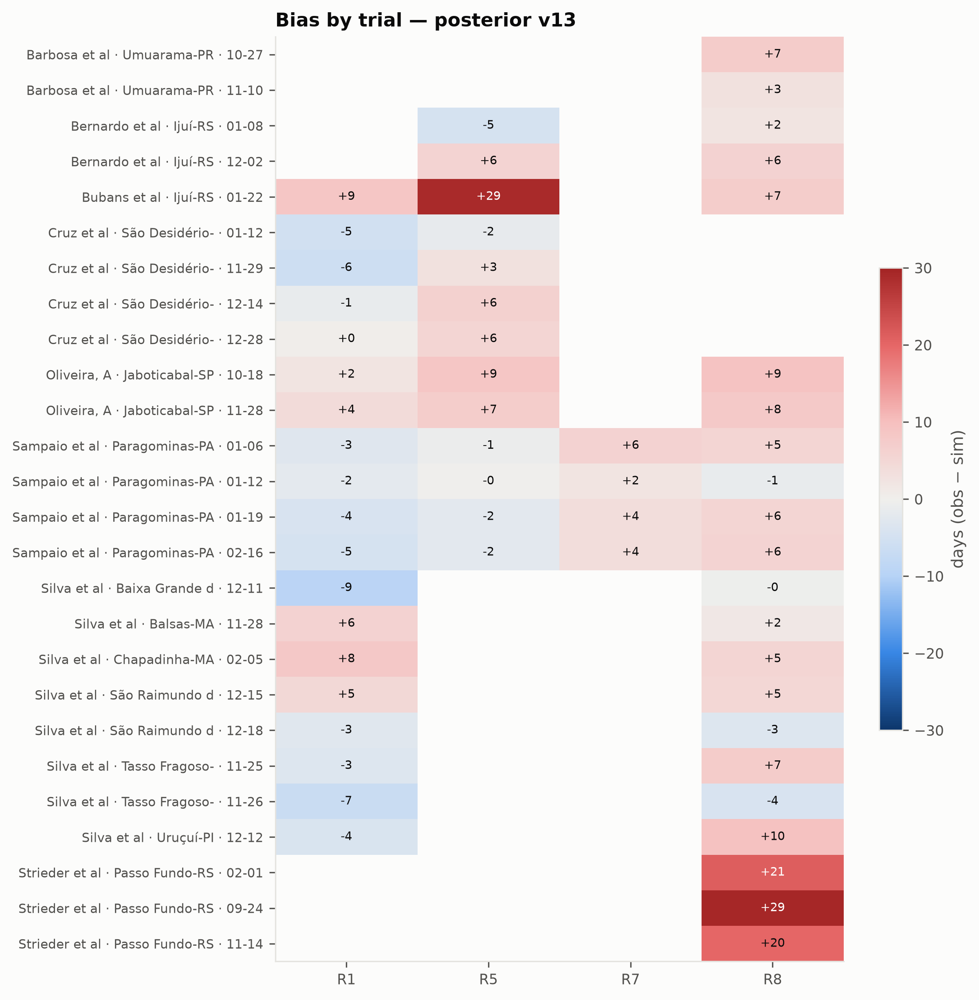

*Comentário:* o viés está concentrado nas **semeaduras precoces do Sul**. Em Passo Fundo, o ciclo observado foi 30 d maior que o simulado na semeadura de setembro e 20–21 d maior em novembro e fevereiro. O viés cai com a semeadura mais tardia em Jaboticabal e Umuarama e fica dentro de ±10 d nos experimentos tropicais. Isso é **limitação estrutural do modelo** com dias longos e frio no início da primavera, e não falha da calibração. Simulações de setembro no Sul pedem cautela.

---

## 8. Cultivar padrão × calibrada: Paragominas (PA)

O experimento de Sampaio et al. (2020) tem GMR 7,7 e 8,8, três épocas e quatro densidades (14 tratamentos), com séries de IAF, biomassa e grãos. Ele foi rodado sem alterações, trocando só a cultivar:

- **padrão:** cultivares genéricas do DSSAT (MG 8 e 9);
- **Sampaio:** coeficientes calibrados *neste* experimento;
- **nacional:** os coeficientes por GMR deste trabalho com o crescimento da BRS 284, sem nenhum ajuste local. Os estádios desse experimento entraram na calibração; o crescimento, não.

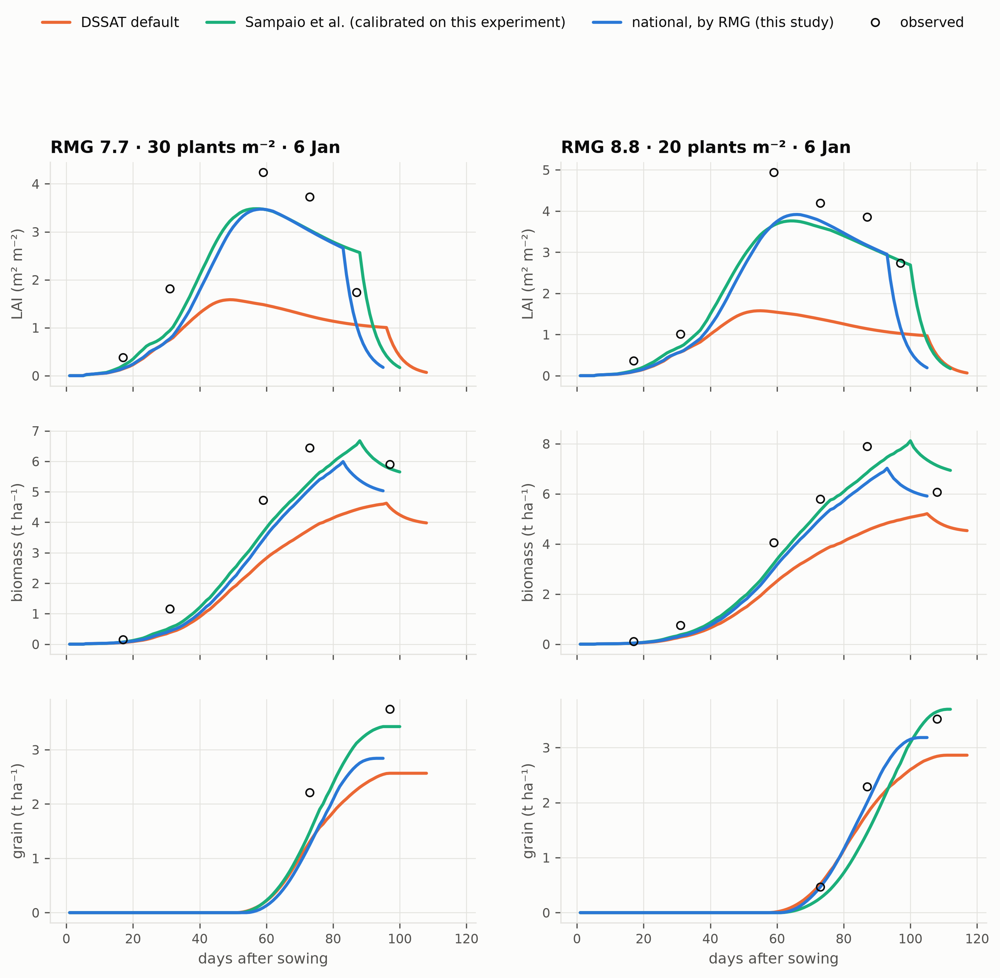

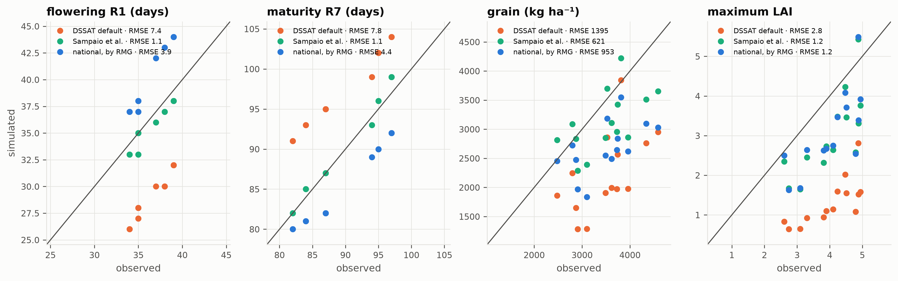

| RMSE | Padrão DSSAT | Sampaio (local) | Nacional por GMR |
|---|---|---|---|
| Florescimento R1 (d) | 7,4 | 1,1 | 3,9 |
| Maturação R7 (d) | 7,8 | 1,1 | 4,4 |
| Grãos (kg/ha) | 1395 | 621 | 953 |
| IAF máximo | 2,8 | 1,2 | 1,2 |

*Comentário:*
- A ordem esperada se confirma: padrão < nacional < local.
- A cultivar **padrão** é inadequada para o Brasil. Ela floresce 7 d cedo demais, tem IAF máximo de 0,6–2,8 contra 2,6–4,9 observado e subestima os grãos em 1,3 t/ha.
- A **nacional por GMR** recupera a maior parte do ganho de uma calibração local onde não há dados locais, e iguala a local no IAF máximo.
- As três versões subestimam os grãos, em parte porque o clima é de grade e não de estação.

Essa figura responde à pergunta prática "vale a pena usar os coeficientes nacionais?".

---

## 9. GMR efetivo e data de semeadura por satélite (2000–2024)

**Método.** SOS e EOS50 do MODIS (250 m, mediana de cerca de 150 pixels de soja) foram invertidos para quatro incógnitas:

- o GMR efetivo *g*;
- a semeadura *s*;
- a defasagem emergência→SOS;
- a defasagem R7→EOS50.

O estimador é um NPE com *neural spline flow*, treinado em 100.000 simulações em que os coeficientes vêm da **posterior calibrada**, de modo que a incerteza da calibração se propaga para *g* e *s*.

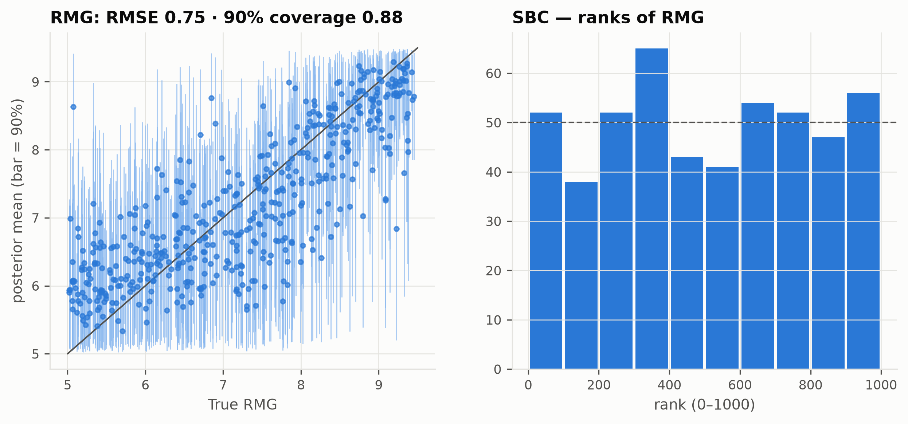

| Incógnita | RMSE | Viés | Cobertura IC 90% | DP da prior |
|---|---|---|---|---|
| GMR efetivo | 0,75 | −0,04 | 0,88 | 1,30 |
| Semeadura (d) | 4,65 | −0,22 | 0,89 | 49,4 |
| Defasagem emergência–SOS (d) | 3,72 | 0,04 | 0,91 | 4,0 |
| Defasagem R7–EOS50 (d) | 5,46 | 0,22 | 0,88 | 6,0 |

*Comentário:* os *ranks* do SBC são quase uniformes, e a cobertura é de 88% para um nominal de 90% (intervalos levemente estreitos). Em 30 registros invertidos também por MCMC, as duas posteriores são praticamente idênticas: r = 0,999, diferença de 0,05 GMR e 1,3 d, e mesmos desvios-padrão (0,52 GMR; 4,8 d).

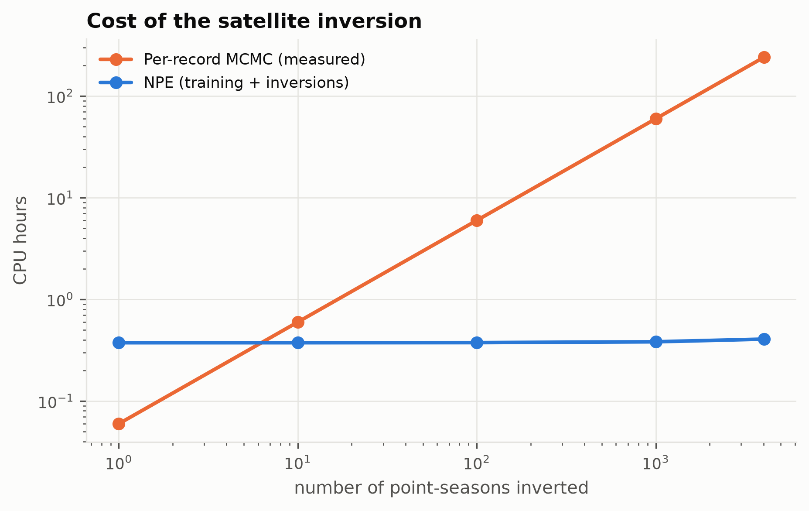

*Comentário:*
- A MCMC por registro leva cerca de 215 s, o que daria cerca de **240 h de CPU** para o país.
- O NPE leva **0,4 h** no total: 22 min de treino e 114 s para inverter os 4.030 registros.
- O NPE compensa a partir de cerca de 7 registros e fica cerca de 600 vezes mais barato na inversão nacional.
- Novas safras podem ser invertidas assim que o MODIS sai.

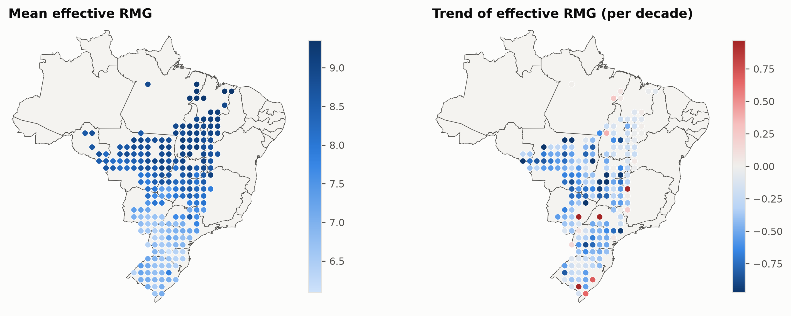

*Comentário:* o gradiente latitudinal do zoneamento de cultivares foi reproduzido **sem nenhuma informação de cultivar**:

| Região | GMR efetivo |
|---|---|
| Sul e PR/SP/MS | 6,9 |
| GO/MG/DF | 8,1 |
| MT/RO | 8,6 |
| MATOPIBA | 9,0 |

Para as safras 2014/15–2017/18, o padrão espacial concorda com o GMR ótimo de Ferreira et al. (2026), obtido de ensaios de produtividade:

| | Este trabalho | Ferreira et al. (2026) |
|---|---|---|
| Por grau de latitude | +0,136 | +0,14 |
| Por 500 m de altitude | −0,13 | −0,2 |

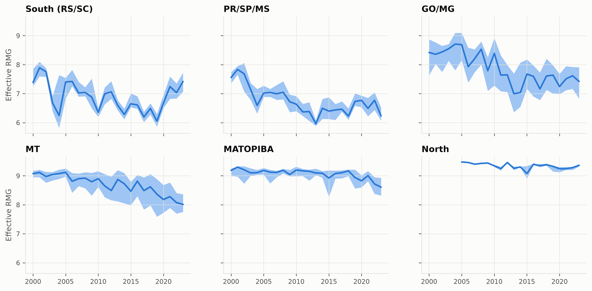

| Região | GMR 2001–05 | GMR 2021–24 | Tendência GMR (/década) | Tendência semeadura (d/década) |
|---|---|---|---|---|
| RS/SC | 7,32 | 7,05 | −0,29 | −2,8 |
| PR/SP/MS | 7,37 | 6,74 | −0,34 | −5,2 |
| GO/MG/DF/norte MS | 8,61 | 7,71 | **−0,50** | −5,4 |
| MT/RO/Norte | 9,02 | 8,22 | **−0,41** | −2,7 |
| MATOPIBA | 9,04 | 8,86 | −0,09 | −5,4 |
| Brasil | | | −0,25 | −3,9 |

*Comentário:*
- **Resultado agronômico central do ASD.** O produtor passou a semear cultivares mais precoces e mais cedo, sobretudo no Centro-Oeste, onde o milho safrinha mais cresceu. É a adaptação esperada do sistema de sucessão soja–milho.
- **No MATOPIBA**, o GMR quase não mudou, mas a semeadura adiantou 5,4 d por década.
- **Validação independente.** Em 2021–24, as médias regionais caem dentro das faixas ótimas de Ferreira et al. (2026) no PR/SP/MS, GO, MT e MATOPIBA.
- **Exceção: o Sul.** O GMR efetivo de 7,05 fica acima do ótimo (5,5–6,4). Há duas explicações possíveis: o modelo subestima o ciclo das semeaduras precoces (Seção 7), e a defasagem R7→EOS50 se confunde com o GMR. As tendências são mais robustas que os valores absolutos.

---

## 10. Limitação hídrica (Yw/Yp)

Yp e Yw foram simulados com o GMR efetivo, a semeadura, a fenologia calibrada e o crescimento da BRS 284, com o manejo de Battisti et al. (2019).

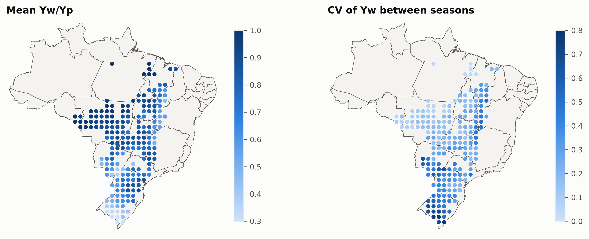

| Região | Yp (t/ha) | Yw (t/ha) | Yw/Yp | P(Yw/Yp < 0,5) | CV de Yw | r região (IBGE) |
|---|---|---|---|---|---|---|
| RS/SC | 4,32 | 2,27 | **0,53** | 0,54 | 0,53 | 0,76 |
| PR/SP/MS | 4,17 | 2,80 | 0,67 | 0,27 | 0,37 | 0,84 |
| GO/MG/DF/norte MS | 4,22 | 3,40 | 0,81 | 0,13 | 0,27 | 0,60 |
| MT/RO/Norte | 3,71 | 3,40 | **0,92** | 0,02 | 0,13 | 0,60 |
| MATOPIBA | 4,21 | 2,93 | 0,71 | 0,18 | 0,25 | 0,85 |
| Brasil | 4,08 | 2,99 | **0,74** | 0,20 | 0,28 | 0,76 |

*Comentário:*
- A água reduz a produtividade em **26% em média**: 8% em MT/RO e 47% no Sul.
- No Sul, **uma safra em cada duas perde mais da metade do potencial**.
- Yw/Yp não teve tendência em nenhuma região. O GMR mais precoce e a semeadura antecipada não mudaram a exposição ao déficit hídrico.
- A ordem entre regiões concorda com Soares et al. (2025) e Sentelhas et al. (2015).

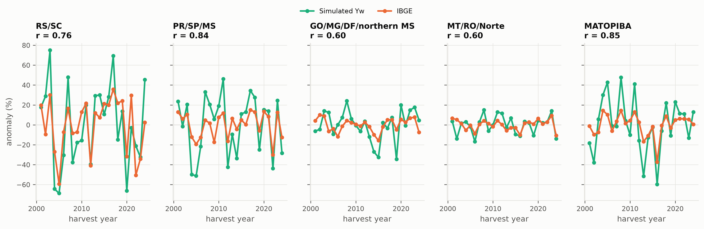

*Comentário:* esta é a validação independente da cadeia toda. As anomalias sem tendência do Yw simulado seguem as do IBGE, com **r = 0,76** por região e safra (0,84 no PR/SP/MS e 0,85 no MATOPIBA).
- **Quebras reproduzidas:**
  - Sul: 2004/05, 2011/12, 2019/20 e 2022/23;
  - PR/SP/MS: 2004/05, 2011/12 e 2021/22;
  - MATOPIBA: 2012/13 e 2015/16.
- **Falharam:** 2021/22 no Sul (−21% simulado contra −51% observado) e 2008/09 no PR/SP/MS.
- **Amplitude:** as anomalias simuladas têm cerca de duas vezes a amplitude das do IBGE, porque o município mistura cultivares, datas e solos.

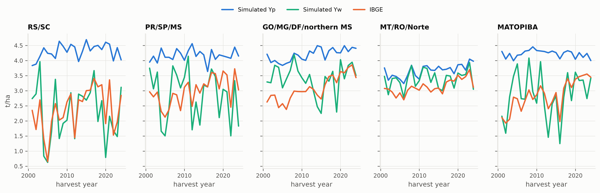

*Comentário:* esta figura mostra **por que se usa Yw/Yp e não a lacuna absoluta Yw − IBGE**. O IBGE cresce cerca de 39 kg/ha por ano. O Yw, simulado com uma cultivar fixa (BRS 284), não cresce: fica abaixo do IBGE em 42% dos pontos-safra, chegando a 52% em 2021–24. A lacuna absoluta exigiria coeficientes de crescimento que acompanhem o ganho genético. A razão Yw/Yp depende sobretudo da fenologia e do clima e é robusta a essa limitação.

---

## 11. Uso no planejamento

Exemplo com as cultivares por ponto em cinco pontos representativos:
- 7 semeaduras, de 15/set a 15/dez;
- 3 GMR: a mediana efetiva de 2021–24 e ±1 unidade;
- 24 safras.

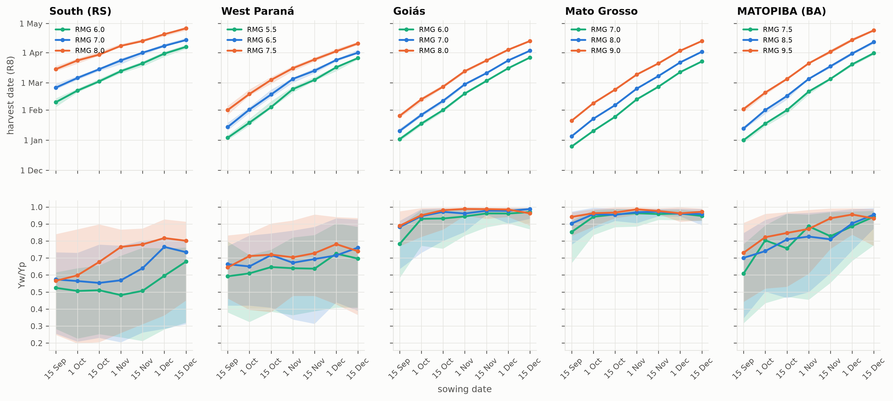

*Comentário* (em cima, data de colheita R8; embaixo, Yw/Yp; faixa = intervalo interquartil entre safras):
- **Calendário:** cada unidade de GMR atrasa a colheita em 11–14 d. Atrasar a semeadura em 15 d atrasa a colheita em 13–14 d nos trópicos, mas só 8 d no Sul, onde o dia mais curto acelera o ciclo.
- **MT e GO:** Yw/Yp fica entre 0,93 e 0,99 a partir de 1/out. A escolha é de **calendário**: o GMR 8,0 semeado em 1/out no MT é colhido por volta de 22/jan, o que libera a janela da safrinha; semeado em 15/nov, só no início de março.
- **MATOPIBA:** a semeadura precoce é o **risco**. Em 15/set, Yw/Yp fica em 0,61–0,73 e há perda acima da metade em até 46% das safras. A partir de 15/nov, fica em 0,81–0,96.
- **PR e RS:** Yw/Yp fica entre 0,48 e 0,82 em todas as combinações, com perda acima da metade em 25–50% das safras. Nenhuma combinação elimina o risco hídrico. No Sul, GMR mais tardio e semeadura em dezembro reduzem a perda média.

É o *trade-off* do sistema soja–safrinha, quantificado com um modelo explícito.

---

## 12. Produtos disponibilizados

| Produto | Onde | Para quê |
|---|---|---|
| Coeficientes θ(GMR) e posterior | `calibracao_mg/produtos/dados/theta_rmg.csv` | Usar o modelo com qualquer GMR |
| Cultivares DSSAT por ponto (224) e genéricas BR do GMR 5,0 ao 9,5 | `SBGRO048_BR.CUL` / `.ECO` | Rodar o DSSAT direto; validado contra o pipeline |
| GMR efetivo e semeadura por ponto e safra | `coefficients_point_season.csv` | Estudos regionais e séries históricas |
| Notebook de uso (Colab) | `produtos/notebooks/usage_example.ipynb` | Para **quem sabe pouco de programação, sem instalar nada**: escolhe-se local, safras e semeaduras, e o notebook baixa o clima NASA/POWER, monta a cultivar e o solo, roda o DSSAT e plota colheita e Yw/Yp |
| Atlas estático (GitHub Pages) | https://fcoliveira-utfpr.github.io/CROPGRO_soybean_br/ | Consultar GMR efetivo, semeadura e cultivar por ponto no mapa |
| Guia de calibração local | `calibracao_mg/produtos/README.md` | Partir da cultivar nacional e ajustar a um experimento próprio |

Dados sob CC BY 4.0. Repositório: https://github.com/fcoliveira-utfpr/CROPGRO_soybean_br

---

## 13. Limitações (para antecipar perguntas)

1. **Semeaduras precoces no Sul.** O modelo subestima o ciclo em 20–30 d, uma limitação estrutural do CROPGRO com dias longos e frio.
2. **GMR efetivo no Sul.** O valor absoluto fica alto, pela confusão com a defasagem R7→EOS50. Use as tendências, não o nível.
3. **Datas de semeadura sem validação de campo.** O próximo teste natural é o calendário agrícola do Paraná (Santana et al., 2024).
4. **Crescimento de uma cultivar fixa (BRS 284).** O modelo não captura o ganho genético; por isso a análise é de limitação relativa e não de lacuna absoluta.
5. **Coeficientes efetivos.** FL-SD e SD-PM ficam nos limites fisiológicos, e os coeficientes valem como conjunto coerente com o crescimento da BRS 284.
6. **Emulador.** O MLP é mais preciso que o GB usado. A troca deslocaria os coeficientes numa ordem de grandeza comparável aos erros do emulador.
7. **Clima de grade.** O BR-DWGD está em ponto de grade; o NASA/POWER do notebook tem cerca de 12% menos chuva que o Xavier.

---

## 14. Mensagens principais

### ASD (agronômico)
- **Primeiro conjunto nacional e consistente** de coeficientes por GMR para o CROPGRO-Soybean no Brasil. Erros de 3,2 d em R1 e 1,9 d em R8 nas médias multilocais.
- **Primeira reconstrução do ciclo efetivamente semeado no país.** O GMR caiu 0,25 por década e a semeadura adiantou 3,9 d por década, com mais força no Centro-Oeste.
- **A água limita 26% da produtividade**, de 8% no MT a 47% no Sul. A variação entre anos concorda com o IBGE (r = 0,76).
- **Ferramenta de planejamento** aberta: notebook e cultivares por ponto.

### MLCSE (computacional)
- Emulador validado em **locais não vistos**, que é o teste relevante para aplicação nacional.
- *Ensembles* independentes e decomposição da log-posterior revelaram **cristas e bimodalidade**. Uma posterior convergida e com melhor ajuste **derrubava a produtividade**: é preciso checar saídas a jusante.
- **O GLUE degenera** (ESS de 1–2) no mesmo problema.
- O **NPE amortizado** dá posteriores iguais às da MCMC por registro, a um custo cerca de 600 vezes menor, e viabiliza a inversão nacional e multidecadal num laptop.

