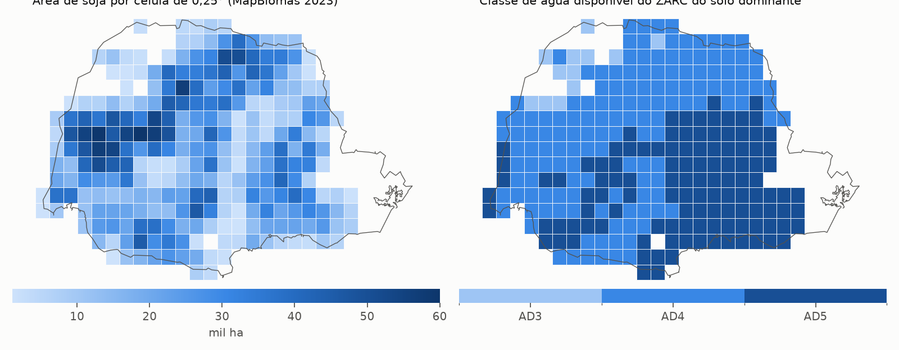
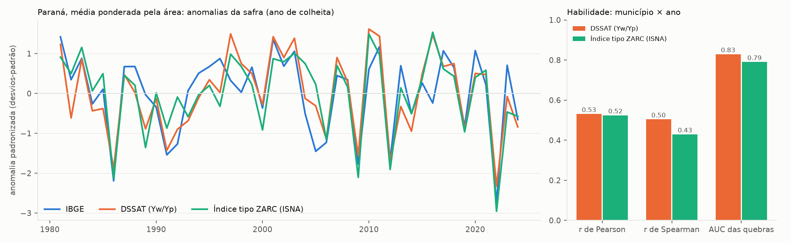
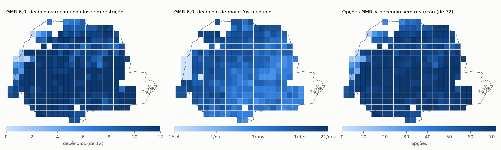
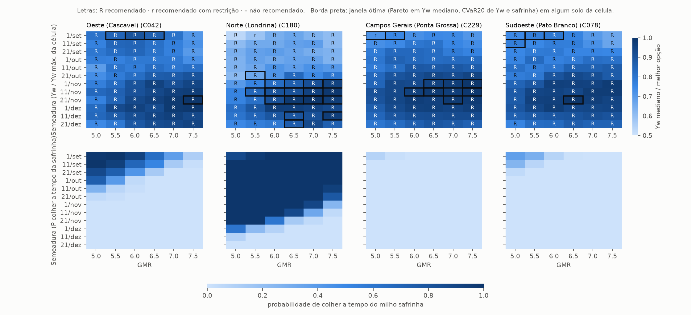
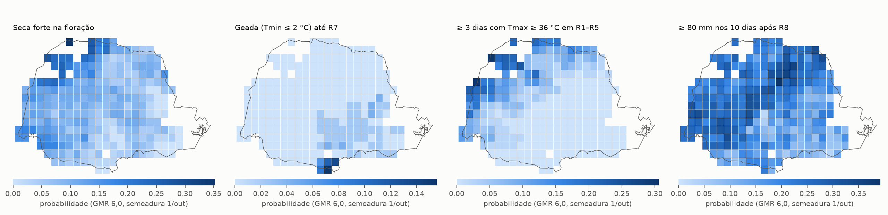
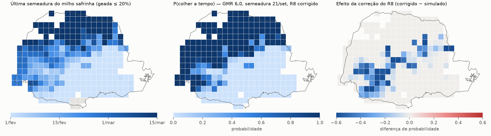

# Zoneamento da soja no Paraná com o CROPGRO-Soybean calibrado

Relatório técnico — 30/10/2026

**Resumo.** Simulamos a soja nos 5,8 Mha cultivados no Paraná: 270 células de 0,25°, 523 combinações célula × solo, 6 grupos de maturidade relativa (GMR 5,0–7,5), 12 decêndios de semeadura (1/set–21/dez) e 45 safras (1980/81–2024/25). Foram 1,69 milhão de safras com água mais as rodadas de produtividade potencial. O modelo é o CSM-CROPGRO-Soybean (DSSAT 4.8) com as cultivares por GMR calibradas nos dois artigos anteriores.

Para cada opção calculamos:
- a distribuição completa da produtividade;
- a perda calibrada pelo IBGE;
- riscos por fase (seca na floração e no enchimento, geada, calor, chuva na colheita);
- a chance de colher a tempo do milho safrinha;
- uma janela ótima multicritério.

Na detecção das quebras de safra do IBGE (336 municípios, 1981–2024), a produtividade relativa simulada supera um índice de satisfação hídrica do tipo ZARC: AUC de 0,83 contra 0,79, com intervalo de 90% da diferença entre 0,013 e 0,067. A série estadual também fica mais próxima da observada (r = 0,83 contra 0,77).

Pelo critério de risco hídrico do ZARC, 96% das opções ficam no nível de 20%, como na portaria. O ganho está no que o ZARC não mostra:
- quanto se perde em cada opção e nos anos ruins (CVaR);
- qual fase concentra o risco;
- onde calor, geada ou chuva na colheita restringem a semeadura;
- o compromisso entre produtividade da soja e janela do milho safrinha, que divide a janela ótima em dois grupos: semeaduras de início de setembro e de novembro.

---

## 1. Objetivo e escopo

O Zoneamento Agrícola de Risco Climático (ZARC) indica, por município, classe de água disponível do solo (AD), grupo de cultivar e decêndio de semeadura, o nível de risco de perda (20, 30 ou 40%). O cálculo usa um balanço hídrico com índice de satisfação de necessidade de água (ISNA) na fase crítica. Este trabalho testa se um modelo de processo calibrado produz um zoneamento mais informativo. Os objetivos são:

1. reproduzir o formato do ZARC (município × classe AD × grupo × decêndio → nível de risco), para comparação direta;
2. ir além das classes de 20/30/40%, com:
   - a distribuição da produtividade;
   - os riscos por fase fenológica;
   - a geada, o calor e a chuva na colheita;
   - a janela do milho safrinha;
   - uma janela ótima multicritério;
3. validar contra a produtividade municipal do IBGE e comparar a habilidade do modelo com a de um índice do tipo ZARC calculado nos mesmos solos e com o mesmo clima.

**Fora do escopo** (para versões futuras):
- camada econômica (preço, custo, seguro);
- ganho genético no crescimento;
- validação com sinistros do seguro rural (SISSER/PROAGRO). O portal do MAPA bloqueou o acesso automático; os dados precisam de download manual.

## 2. Decisões de projeto

| Item | Decisão | Motivo |
|---|---|---|
| Região e grade | Paraná; células de 0,25° com mais de 1.000 ha de soja (MapBiomas col. 10, 2023) | 270 células, 5,80 Mha; altitude média 209–1.244 m |
| Clima | Xavier BR-DWGD (0,1°), pixel do centro da célula, 1980–2025 | Mesma base da calibração |
| Cultivares | `BRG050`–`BRG075` de `SBGRO048_BR.CUL/.ECO`, publicadas nos artigos (fenologia θ(GMR) v13, medianas de 9.000 passos; crescimento da BRS 284) | Usadas como publicadas, sem recalibração |
| Solos | 3 solos de Battisti & Sentelhas (2019, Tab. S1: francoarenoso, argiloarenoso, argiloso), escolhidos pela classe textural do MapBiomas Solo (col. 3) sob a soja da célula e pesados pela área; solos com ≥ 5% da soja da célula | Na calibração, essa configuração acompanhou melhor o IBGE (r 0,44) que os perfis por PTF (r 0,27); nos testes iniciais deste trabalho, a PTF deu Yw/Yp ≈ 0,3 no Oeste, contra 0,48 com B&S e 0,53 nos artigos |
| AWC da ANA | Fora | O DSSAT calcula a água ao alcance das raízes camada a camada; a CAD = AWC × profundidade efetiva não entra no modelo. Ficou só como chave opcional (desligada) de reescalonamento do DUL |
| Execução | Executável do DSSAT chamado direto, FileX com até 99 tratamentos, 45 safras por chamada | ~35 ms por safra; resultado idêntico ao DSSATTools (seção 3.1) |
| Produtividade | Produtividade relativa (Yw/Yp) e Yw relativo ao melhor manejo da célula; nenhuma produtividade absoluta é interpretada | Crescimento da BRS 284 sem ganho genético |
| Fenologia | R7/R8 corrigidos pela data de semeadura **só** nos indicadores de calendário; produtividade sem correção | O modelo capta só parte do alongamento do ciclo nas semeaduras precoces (seção 3.3) |
| Milho safrinha | Incluído | Principal fator na escolha da época no PR |

## 3. Métodos

### 3.1 Execução direta do DSSAT

`src/dssat_direto.py` monta uma pasta de rodada com as cultivares brasileiras, o arquivo de clima (`ZNPR8045.WTH`, 45 anos), os solos da célula num `SOIL.SOL` e um FileX com um tratamento por combinação solo × GMR × decêndio × regime hídrico. Detalhes da implementação:
- Cada FileX é rodado no modo A com até 99 tratamentos, porque o campo TRNO tem 2 colunas; acima disso, os tratamentos são divididos em blocos.
- Simulação começa em 15/mar do ano da semeadura, com água inicial a 75% da capacidade.
- Plantio na data do decêndio; colheita na maturidade.
- Rodadas sem estresse hídrico (Yp) só no solo principal, porque Yp não depende do solo.
- Saídas: `Summary.OUT` (datas, produtividade, chuva, ET) e `OVERVIEW.OUT`, de onde se lê a tabela de estresses por fase (emergência–R1, R1–R5 e R5–R7):
  - estresse hídrico na fotossíntese e no crescimento;
  - temperaturas médias;
  - chuva;
  - dias com Tmin < 0 e < 2 °C;
  - dias com Tmax > 32 e > 34 °C.
- A numeração de rodadas do OVERVIEW reinicia depois de 999, por isso as rodadas são contadas em sequência.

**Conferência** (`etapa0_validar.py`): 45 safras de um ponto do Oeste rodadas direto e pelo DSSATTools. As únicas diferenças vinham de dois arredondamentos do DSSATTools ao reescrever a cultivar: FL-SD 11,59 → 11,6 e PM09 0,35 → 0,3. Com os mesmos valores, as 45 safras foram idênticas.

**Custo** (`etapa0_custo.py`): 12.960 safras em 457 s, cerca de 35 ms por safra num processo. A etapa 2 completa levou 9,1 h com 4 processos, entre 4 e 13 min por célula conforme o número de solos.

### 3.2 Grade, solos e clima (etapa 1)

- **Células:** quadrados de 0,25° que tocam o PR, com a área de soja do MapBiomas recortada no estado. Ficaram as 270 com mais de 1.000 ha.
- **Solos:** para cada célula, perfis do MapBiomas Solo (areia, silte e argila em 6 camadas até 100 cm) e do SoilGrids, por classe textural sob a soja.
- **Limpeza:** em algumas células a soma das frações ficava abaixo de 100% (pixels sem dado). O tratamento foi:
  - camadas com soma ≥ 50% são normalizadas;
  - abaixo de 40 cm, uma camada sem dado copia a de cima;
  - perfis sem dado em 0–40 cm são descartados (14 perfis, 0,02% da área).
- **Água disponível do ZARC:** calculada pela equação da IN SPA/MAPA nº 1/2022 com a textura de 0–40 cm. Área de soja por classe: AD3 2%, AD4 59,6% e AD5 38,3% (figura 1).
- **Solos simulados:** 523 combinações célula × solo; 203 células com 2 solos, 42 com 1 e 25 com 3. Peso total: argiloso 61%, argiloarenoso 33%, francoarenoso 6%. A água disponível em 0–100 cm é de 149, 100 e 60 mm, respectivamente.



*Figura 1. Área de soja por célula e classe AD do ZARC do solo dominante.*

### 3.3 Viés fenológico e correção do R7/R8

O modelo calibrado tem viés conhecido nas semeaduras fora da época central. Em `etapa0_fenologia.py` comparamos o R8 simulado com o observado em ensaios de época de semeadura (Umuarama, Jaboticabal, Passo Fundo e Ijuí), usando cultivares com o GMR exato:

| Local | Semeadura | Viés do R8 (d) |
|---|---|---|
| Umuarama-PR | 27/out | −5,8 |
| Umuarama-PR | 10/nov | −2,1 |
| Jaboticabal-SP | 18/out | −10,7 |
| Jaboticabal-SP | 28/nov | −5,0 |
| Passo Fundo-RS | 24/set | −29,5 |
| Passo Fundo-RS | 14/nov | −15,9 |
| Ijuí-RS | várias | −1 a −5 |

Entre semeaduras de set–out e de novembro, o modelo reproduz só 50–60% do alongamento observado do ciclo.

A correção empírica (`fenologia_correcao.py`) acrescenta k × max(0, 10/nov − semeadura) dias ao R7 e ao R8. A inclinação, ajustada dentro de cada local, é k = 0,287 d/d (IC90 0,25–0,29; Jaboticabal 0,25, Umuarama 0,26, Passo Fundo 0,29). Uma semeadura em 1/set ganha 20 dias de ciclo; uma em 1/out, 11 dias. O R8 é o R7 + 11 dias, como nos artigos.

A correção vale só para os indicadores de calendário: geada até R7, chuva após R8 e colheita a tempo da safrinha. A produtividade não é corrigida, e os decêndios de setembro têm menor confiança. A sensibilidade sem correção (k = 0) está nas colunas `*_sc`.

### 3.4 Indicadores por safra (etapa 3)

Para cada safra × célula × solo × GMR × decêndio:

| Indicador | Definição |
|---|---|
| `ry` | Yw/Yp da mesma safra, célula, GMR e decêndio |
| `seca_veg/flor/ench` | estresse hídrico no crescimento (0–1, OVERVIEW) em emergência–R1, R1–R5 e R5–R7 |
| `calor36` | dias com Tmax ≥ 36 °C entre R1 e R5 (clima diário) |
| `geada` | Tmin ≤ 2 °C entre a emergência e o R7 corrigido |
| `chuva_colh` | chuva nos 10 dias após o R8 corrigido |
| `safrinha` | R8 corrigido + 3 dias ≤ data-limite do milho safrinha da célula |
| `ciclo_r8c` | dias da semeadura ao R8 corrigido |

**Data-limite do milho safrinha** (por célula): a última data de semeadura entre 1/jan e 15/mar em que P(Tmin ≤ 2 °C entre 50 e 120 dias após a semeadura do milho) ≤ 20%, calculada no clima de 1981–2024.

### 3.5 Perda calibrada, nível de risco e classes (etapa 4)

**Perda da safra:** perda = β · (1 − ry / ry_normal).
- ry_normal é a mediana de ry do manejo representativo do PR (semeaduras de 21/set a 1/nov, GMR 6,0 e 6,5) na célula × solo. Faz o papel da tendência do IBGE: o rendimento "normal" do local.
- β ajusta a amplitude. As anomalias simuladas têm desvio de 0,36, contra 0,17 nas anomalias municipais do IBGE, porque o modelo exagera as quebras no Sul. O modelo dá o padrão (quando, onde e com que manejo a quebra acontece), e o IBGE dá a amplitude.

**Escolha de β.** Comparamos três calibrações:

| Calibração | β | Lógica | Opções no nível 20 / 30 / 40% (peso da área) |
|---|---|---|---|
| Regressão (inclinação do IBGE sobre a simulada) | 0,259 (IC90 0,18–0,33) | Melhor previsão da média | 100 / 0 / 0% |
| **Frequência (adotada)** | **0,395** | No manejo representativo, P(perda > 20%) = 12,4%, a fração de quebras do IBGE | **96,4 / 3,4 / 0,2%** |
| Variância (razão dos desvios) | 0,482 | Iguala a variância das anomalias | 78,2 / 19,0 / 2,7% (0,1% sem indicação) |

A inclinação da regressão é a melhor previsão da média, mas encolhe a variância (β_reg = r × desvio_IBGE / desvio_simulado) e subestima as caudas. Com ela, nenhuma opção passa de 20%, e a classificação perde a função. A razão dos desvios iguala a variância, mas inclui o ruído municipal do IBGE (área, tecnologia, erros de levantamento), que não é risco climático, e superestima a frequência de quebras (17,9% no manejo típico). A calibração pela frequência usa diretamente a definição do ZARC: no manejo típico, o modelo marca perda acima de 20% na mesma frequência das quebras observadas.

**Estatísticas por opção (45 safras):**
- ry mediano, P20 e CVaR20 de ry (média dos 20% piores anos);
- Yw mediano e CVaR20 de Yw;
- P(perda > 20, 30, 40%);
- P(seca forte, ≥ 0,5, na floração e no enchimento);
- P(geada), P(calor: ≥ 3 dias com Tmax ≥ 36 °C), P(chuva ≥ 80 mm na colheita), P(safrinha);
- R8 corrigido mediano e duração do ciclo.

**Nível de risco hídrico** (análogo ao ZARC): o menor nível em {20, 30, 40%} tal que P(perda > 20%) ≤ nível. Acima de 40%, a opção fica sem indicação.

**Restrições:**
- geada > 20%;
- calor > 20%;
- chuva na colheita > 40%.

**Classes:**
- **recomendado:** nível 20% e nenhuma restrição;
- **recomendado com restrição:** nível 30%, ou nível 20% com alguma restrição, com o motivo indicado;
- **não recomendado:** o resto.

**Janela ótima:** em cada célula × solo, as opções recomendadas (com ou sem restrição) não dominadas, no sentido de Pareto, em três critérios: Yw mediano, CVaR20 de Yw e P(safrinha).

Usamos Yw e não ry porque Yp cai nas semeaduras tardias e o ry subiria mesmo com a produtividade caindo. Com o ry, a "melhor" opção saía em dezembro em todas as regiões. Comparar Yw dentro da mesma célula não exige interpretar o nível absoluto. Nas figuras, Yw aparece relativo ao melhor manejo da célula.

**Agregação** (`opcoes_celula.csv`): estatísticas ponderadas pelo peso dos solos e reclassificadas.

**Tabela municipal** (`tabela_municipal.csv`): formato do ZARC, com município (centroide → célula mais próxima, até 0,25°) × textura/classe AD × grupo (I ≤ 5,5; II 6,0–6,5; III ≥ 7,0) × decêndio. Os decêndios seguem a numeração do ZARC: 1/set = 25 … 21/dez = 36.

### 3.6 Índice do tipo ZARC (ISNA)

As portarias do ZARC não puderam ser baixadas automaticamente. Por isso, reproduzimos o índice com os mesmos solos e clima (`zarc_proxy.py`):
- balanço hídrico diário de um reservatório com CAD = AD × 50 cm (AD da IN 1/2022);
- curva de Kc da soja;
- coeficiente de estresse do FAO-56 com p = 0,5;
- ciclo fixo por grupo (105, 120 e 135 dias);
- ISNA = ETr/ETm médio na fase crítica (40–80% do ciclo).

Esse índice mantém a estrutura do ZARC, mas não é idêntico ao oficial. A comparação com a portaria publicada fica pendente (seção 7).

### 3.7 Validação (etapa 5)

**Dados:** produtividade municipal da soja do IBGE (PAM, tabela SIDRA 1612), 1980–2024. Entram só municípios do PR com ≥ 15 anos e ≥ 1.000 ha: 336 municípios, 12.964 município-anos.

**Anomalias:**
- **IBGE:** produtividade / tendência − 1. A tendência é um LOWESS por município (fração 0,5, 3 iterações), que remove o ganho tecnológico.
- **Quebra:** anomalia < −20%. Ocorre em 12,4% dos município-anos.
- **Modelo:** cada município recebe a célula mais próxima do centroide (382 municípios em 215 células). A anomalia é ry / mediana − 1 no manejo representativo, com solos pesados pela área.
- **ISNA:** a anomalia é calculada do mesmo jeito, no mesmo manejo e com os mesmos solos.

**Métricas:**
- correlação de Pearson e de Spearman em município × ano;
- AUC na detecção de quebras;
- correlação mediana por município;
- correlação da série estadual (anomalias médias ponderadas pela área).

A incerteza da diferença DSSAT − ISNA vem de *bootstrap* por ano: os anos são reamostrados com todos os municípios juntos, o que preserva a correlação espacial.

## 4. Resultados

### 4.1 Validação

| Métrica (município × ano) | DSSAT (ry) | ISNA (tipo ZARC) | Diferença (IC90) |
|---|---|---|---|
| r de Pearson | 0,531 | 0,524 | −0,036 a 0,070 |
| r de Spearman | 0,504 | 0,429 | — |
| AUC das quebras (< −20%) | **0,829** | 0,790 | **0,013 a 0,067** |
| r mediano por município | 0,549 | 0,531 | — |
| r da série estadual | **0,826** | 0,770 | — |

O modelo detecta as quebras melhor que o índice do tipo ZARC, e a diferença no AUC é significativa. Na correlação linear município × ano os dois empatam. O ganho está nos anos extremos, que são o que importa para risco.

A correlação de Spearman favorece o DSSAT por margem maior (0,50 contra 0,43). Uma explicação provável é que o ISNA satura em anos normais, com valores perto de 1, enquanto o ry continua discriminando; isso não foi testado diretamente.



*Figura 2. Anomalias estaduais padronizadas (IBGE, DSSAT e ISNA) e habilidade em município × ano.*

As grandes quebras do IBGE (1986, 1991, 2009, 2012, 2022) aparecem nos dois índices, e o DSSAT as marca com maior amplitude. A amplitude simulada é cerca de 2 vezes a do IBGE, o que é a razão do β. Os principais desencontros:
- **2005 (IBGE −19%):** o DSSAT dá −10% e o ISNA +1%. Hipótese: a seca de 2004/05 foi localizada, e o pixel de 0,1° e os solos médios a suavizam.
- **2016 (IBGE −5%):** o DSSAT dá +39% e o ISNA +22%. Hipótese: perdas por excesso de chuva na colheita e por doenças, que nenhum dos dois representa.

Anomalias estaduais por safra (ano de colheita; média ponderada pela área):

| Safra (colheita) | IBGE | DSSAT (ry) | ISNA |
|---|---|---|---|
| 1981 | +13% | +32% | +12% |
| 1982 | +1% | −19% | +5% |
| 1983 | +7% | +22% | +16% |
| 1984 | −6% | −14% | −2% |
| 1985 | −1% | −12% | +5% |
| 1986 | −27% | −54% | −38% |
| 1987 | +5% | +11% | +4% |
| 1988 | +5% | −1% | +0% |
| 1989 | −3% | −26% | −25% |
| 1990 | −6% | −6% | −3% |
| 1991 | −20% | −41% | −17% |
| 1992 | −17% | −27% | −5% |
| 1993 | −2% | −21% | −13% |
| 1994 | +3% | −5% | −4% |
| 1995 | +5% | +8% | +0% |
| 1996 | +7% | −1% | −8% |
| 1997 | +1% | +39% | +13% |
| 1998 | −2% | +19% | +8% |
| 1999 | +5% | +12% | +1% |
| 2000 | −7% | −10% | −18% |
| 2001 | +13% | +37% | +11% |
| 2002 | +5% | +23% | +10% |
| 2003 | +9% | +36% | +13% |
| 2004 | −8% | −5% | +9% |
| 2005 | −19% | −10% | +1% |
| 2006 | −17% | −33% | −22% |
| 2007 | +2% | +23% | +8% |
| 2008 | +1% | +6% | −0% |
| 2009 | −23% | −45% | −38% |
| 2010 | +4% | +43% | +21% |
| 2011 | +11% | +38% | +13% |
| 2012 | −21% | −49% | −34% |
| 2013 | +5% | −11% | −1% |
| 2014 | −8% | −28% | −11% |
| 2015 | +0% | +11% | +3% |
| 2016 | −5% | +39% | +22% |
| 2017 | +10% | +17% | +7% |
| 2018 | +5% | +19% | +4% |
| 2019 | −12% | −27% | −19% |
| 2020 | +10% | +12% | +3% |
| 2021 | −0% | +11% | +6% |
| 2022 | −34% | −66% | −51% |
| 2023 | +5% | −4% | −11% |
| 2024 | −10% | −25% | −13% |

### 4.2 Nível de risco e classes

Com β = 0,395, P(perda > 20%) por opção varia de 0 a 0,38. Ponderado pela área dos solos:
- **Nível:** 96,4% das opções ficam em 20%, 3,4% em 30% e 0,2% em 40%.
- **Classes:** 91,8% recomendado, 8,0% recomendado com restrição e 0,2% não recomendado.

A distribuição é parecida com a da portaria do ZARC para a soja no PR, em que quase todo o estado fica no nível de 20% entre outubro e dezembro.

As opções acima de 20% concentram-se nas semeaduras de setembro: 15% das opções célula × GMR em 1/set e 13,5% em 11/set, contra 5% em 1/out e menos de 2% de 21/out em diante. Concentram-se no Norte e no Noroeste (latitude mediana −23,6°, longitude mediana −51,6°).

**Restrições** (opções célula × GMR × decêndio):

| Restrição | Fração das opções |
|---|---|
| Nenhuma | 94,4% |
| Calor (Tmax ≥ 36 °C na floração) | 4,1% |
| Geada até R7 | 0,9% |
| Chuva na colheita | 0,6% |

- **Calor:** Noroeste e extremo Oeste, em todas as épocas.
- **Geada:** semeaduras de 1/set (P média 7,8%, acima de 20% no Sul e nos Campos Gerais) e células de altitude no Sul.
- **Chuva na colheita:** abaixo do limite de 40% em quase todo o estado, mas com P mediana de 20% em 1/out e até 39% no Centro-Norte (figura 4).



*Figura 3. GMR 6,0: decêndios recomendados sem restrição, decêndio de maior Yw mediano, e número de opções GMR × decêndio sem restrição (de 72).*

### 4.3 Produtividade e risco ao longo da época de semeadura

Medianas por célula, todas as GMR:

| Semeadura | Yw/Yp | CVaR20 de ry | Yw relativo* | P(seca forte na floração) | P(geada) | P(calor) | P(safrinha) |
|---|---|---|---|---|---|---|---|
| 1/set | 0,60 | 0,27 | 0,79 | 0,03 | 0,08 | 0,05 | 0,54 |
| 21/set | 0,60 | 0,26 | 0,77 | 0,07 | 0,01 | 0,05 | 0,48 |
| 11/out | 0,64 | 0,28 | 0,84 | 0,07 | 0,00 | 0,04 | 0,38 |
| 1/nov | 0,70 | 0,31 | 0,95 | 0,04 | 0,00 | 0,04 | 0,26 |
| 21/nov | 0,74 | 0,33 | 1,00 | 0,03 | 0,00 | 0,04 | 0,12 |
| 11/dez | 0,74 | 0,33 | 0,94 | 0,04 | 0,00 | 0,04 | 0,00 |

\* Yw mediano da semeadura dividido pelo maior Yw mediano entre as semeaduras (21/nov).

- **Yw:** cresce de setembro até 21/nov–1/dez e cai depois. No GMR 6,0, o decêndio de maior Yw mediano fica entre 1/nov e 1/dez em 85% das células (1/dez em 27%).
- **Seca na floração:** risco máximo nas semeaduras de 21/set a 11/out. A floração cai em novembro e dezembro, quando os veranicos do Oeste e Noroeste são mais frequentes.
- **Safrinha:** a probabilidade de colher a tempo cai de 0,54 em 1/set para 0,12 em 21/nov.

**Ressalva sobre a curva de Yw.** O modelo encurta o ciclo das semeaduras precoces (seção 3.3), o que penaliza a produtividade de setembro e outubro. Parte da vantagem de novembro é desse viés. A ordem entre semeaduras de outubro e novembro deve ser lida com essa limitação, e não como recomendação de semeadura tardia.

**Ciclo corrigido mediano (semeadura–R8) por GMR:**

| GMR | 5,0 | 5,5 | 6,0 | 6,5 | 7,0 | 7,5 |
|---|---|---|---|---|---|---|
| Ciclo (dias) | 116 | 120 | 126 | 131 | 136 | 144 |

### 4.4 Matrizes de decisão por região



*Figura 4. Matrizes GMR × decêndio em quatro células representativas. Em cima: Yw mediano relativo ao melhor manejo da célula, classe (R/r/–) e janela ótima (borda preta). Embaixo: probabilidade de colher a tempo do milho safrinha.*

- **Oeste (Cascavel, C042):** 72 de 72 opções recomendadas. A janela ótima tem dois grupos:
  - 1/set com GMR 5,5–6,5, com probabilidade de colher a tempo da safrinha de 0,64 a 1,0;
  - 21/nov com GMR 7,5, de maior Yw mediano.

  O agricultor que planta milho safrinha escolhe o primeiro grupo; quem não planta, o segundo. A distância entre eles (Yw relativo de 0,85 a 0,90 contra 1,0) é o custo de oportunidade da safrinha na soja, segundo o modelo, e está inflada pelo viés fenológico das semeaduras precoces (seção 3.3).
- **Norte (Londrina, C180):** a safrinha é viável até semeaduras de novembro com GMR precoce, porque a data-limite do milho vai até 15/mar. A janela ótima fica em novembro, com GMR 5,5–7,5. Há uma restrição (calor) em 1/set com GMR 5,5.
- **Campos Gerais (Ponta Grossa, C229):** a safrinha praticamente não é viável, porque a geada limita o milho (P ≤ 0,09). A janela ótima fica em novembro com GMR 6,0–7,5, mais uma opção em 1/set com GMR 5,5. A opção 1/set com GMR 5,0 cai no nível 30% de risco hídrico.
- **Sudoeste (Pato Branco, C078):** a safrinha é marginal, com P de no máximo 0,37 em 1/set com GMR 5,0. A janela ótima tem os dois grupos, setembro com GMR 5,0–6,0 e 21/nov com GMR 6,5.

Em todo o estado, a janela ótima tem em média 8,4 opções por célula × solo (de 1 a 22). Ela se divide entre 1/set–11/set (22%) e 1/nov–1/dez (59%). Os GMR mais frequentes são 5,5 a 6,5 (66% das opções na janela).

### 4.5 Riscos por fase



*Figura 5. GMR 6,0, semeadura em 1/out: probabilidades de seca forte na floração, geada até R7, calor na floração e chuva na colheita.*

Na semeadura de referência (GMR 6,0, 1/out):

| Risco | Mediana entre células | Máximo | Onde |
|---|---|---|---|
| Seca forte na floração | 0,09 | 0,35 | Noroeste e Oeste |
| Geada | 0,00 | 0,16 | Sul, em altitude |
| Calor | 0,00 | 0,31 | Noroeste |
| Chuva ≥ 80 mm na colheita | 0,20 | 0,39 | Centro-Norte e Norte |

O ZARC não informa nenhum desses riscos separadamente: todos se resumem a um ISNA único na fase crítica.

### 4.6 Milho safrinha



*Figura 6. Data-limite da semeadura do milho safrinha (geada ≤ 20%), probabilidade de colher a soja a tempo (GMR 6,0, 21/set, R8 corrigido) e efeito da correção do R8.*

- **Data-limite do milho:** vai de 4/jan no Sul a 15/mar no Norte, com mediana em 16/fev. Em 5 células do extremo Sul nenhuma data entre 1/jan e 15/mar tem risco de geada ≤ 20% (em branco).
- **Probabilidade de colher a tempo** (GMR 6,0, 21/set): perto de 1 no Norte e no Noroeste, entre 0,4 e 0,8 no Oeste, e quase zero no Centro-Sul.
- **Efeito da correção do R8:** como ela alonga o ciclo das semeaduras precoces, a probabilidade cai até 0,72 nas células do Oeste e Sudoeste, onde a data-limite está perto da colheita. No manejo representativo, a média cai de 0,47 sem correção para 0,41 com correção. Sem a correção, o zoneamento superestimaria a janela da safrinha justamente onde ela é marginal.

## 5. Comparação com o ZARC

| Aspecto | ZARC (portaria) | Este zoneamento |
|---|---|---|
| Modelo | Balanço hídrico de reservatório (CAD da classe AD), ISNA na fase crítica, ciclo fixo por grupo | CROPGRO-Soybean: fenologia por fotoperíodo e temperatura calibrada por GMR, crescimento, água no perfil por camada |
| Saída | Nível de risco (20/30/40%) por município × AD × grupo × decêndio | O mesmo nível, mais: distribuição de Yw/Yp, CVaR, perda calibrada, riscos por fase, geada, calor, chuva na colheita, safrinha, ciclo, janela ótima |
| Ciclo | Fixo por grupo | Varia com a época e o local; ciclo e datas corrigidos pela época |
| Solo | Classe AD (CAD de 50 cm) | Perfis de B&S por classe textural do MapBiomas, pesados pela área |
| Validação publicada | Não disponível por município × ano | IBGE: AUC 0,83 contra 0,79 do índice do tipo ZARC; série estadual r 0,83 contra 0,77 |
| Safrinha | Não considera | Probabilidade de colher a tempo, com a data-limite do milho por célula |

O nível de risco calibrado reproduz o padrão geral do ZARC no PR, com quase tudo no nível 20%. Isso é esperado: o PR tem baixo risco hídrico para a soja, e o nível por si só discrimina pouco. Para o produtor e o técnico, a informação útil está nas métricas contínuas e nos riscos não hídricos.

Uma comparação célula a célula com a portaria oficial depende de baixar as tabelas do ZARC (pendente).

## 6. Limitações

1. **Fenologia nas semeaduras precoces.** O modelo capta só 50–60% do alongamento do ciclo. A correção cobre as datas, mas não a produtividade; a vantagem simulada das semeaduras de novembro está em parte inflada. Os decêndios de setembro têm menor confiança.
2. **Produtividade absoluta.** O crescimento da BRS 284 não tem ganho genético. Só comparamos Yw dentro da mesma célula, e só ry entre locais.
3. **Amplitude das quebras.** O modelo exagera as quebras (desvio 2× o do IBGE). O β corrige a amplitude, mas o nível de risco depende da escolha do β (seção 3.5): com β pela variância, 22% das opções sairiam do nível 20%.
4. **Fatores não simulados:** doenças (ferrugem), pragas, excesso de chuva no ciclo e qualidade de grão. Explicam desencontros como o de 2016.
5. **Solos:** 3 solos-tipo por classe textural, não perfis locais. A textura do MapBiomas tem lacunas, tratadas na limpeza. O mesmo problema pode afetar os perfis de 1° usados na calibração (a verificar).
6. **Clima:** pixel de 0,1° no centro da célula. Chuvas convectivas locais e efeitos de relevo em células heterogêneas ficam suavizados.
7. **Índice do tipo ZARC:** é uma reprodução da metodologia, não a portaria oficial.
8. **Validação:** IBGE municipal (com ruído de área e tecnologia) e sem sinistros do seguro.
9. **GMR:** usamos os GMR de cultivares (5,0–7,5). O GMR efetivo inferido do satélite (artigo MLCSE) é maior no Sul. A escolha de grupo pelo agricultor real pode diferir.

## 7. Pendências

- **Tabelas do ZARC** da soja no PR (portaria vigente) e dados de sinistros (SISSER, PROAGRO/SICOR): precisam de download manual, porque o portal do MAPA bloqueou o acesso automático. Com elas:
  - comparar o nível de risco célula a célula;
  - validar a frequência de perdas contra sinistros.
- **Sensibilidade aos solos:** rodar com perfis por PTF (`ZN_SOLO=ptf`, já implementado; ~9 h).
- **Robustez temporal:** 1981–2002 × 2003–2024.
- **Incerteza dos coeficientes:** rodar o mesmo desenho com amostras da posterior v13.
- **Camada econômica:** preço, custo e seguro.

## 8. Produtos

| Arquivo | Conteúdo |
|---|---|
| `resultados/opcoes.csv` | uma linha por célula × solo × GMR × decêndio: estatísticas, nível, restrições, classe, janela ótima, peso do solo |
| `resultados/opcoes_celula.csv` | o mesmo, ponderado pelos solos (célula × GMR × decêndio) |
| `resultados/opcoes_reg.csv`, `opcoes_var.csv` (e `_celula`) | sensibilidade ao β (regressão e variância) |
| `resultados/tabela_municipal.csv` | formato do ZARC: 382 municípios × textura/AD × grupo × decêndio (56.520 linhas) |
| `resultados/safrinha_limite.csv` | data-limite do milho safrinha por célula |
| `resultados/validacao_resumo.json`, `validacao_estado_ano.csv`, `validacao_municipio_ano.csv` | validação |
| `resultados/fenologia_correcao.json`, `etapa0_fenologia.csv` | viés e correção do R7/R8 |
| `resultados/solos_usados.csv` | solos simulados, pesos, AD e classe do ZARC |
| `resultados/numeros_relatorio.json` | números citados neste relatório |
| `resultados/figuras/*.png` | figuras 1–6 |

No repositório, as tabelas grandes estão compactadas (`opcoes.csv.gz`, `opcoes_celula*.csv.gz`, `tabela_municipal.csv.gz`, `validacao_municipio_ano.csv.gz`, `preditores_celula_ano.csv.gz`). Da sensibilidade ao β, só a versão por célula. As simulações brutas (`resultados/sim/*.parquet`, 270 arquivos, 125 MB) e os indicadores por safra (`indicadores_safra.parquet`, 1,69 milhão de linhas) não vão para o repositório. Podem ser regenerados pelo pipeline.

## 9. Reprodutibilidade

Ambiente: `../calibracao_mg/.venv` (Python 3.11, DSSAT 4.8 do DSSATTools, pandas, scikit-learn, earthengine-api). Variáveis da calibração: `DELTA8_FIXO=11 PRIOR_LIT=1 FAIXA_FISIO=1`.

```bash
cd dssat_zone
PY=../calibracao_mg/.venv/bin/python
$PY src/etapa0_custo.py; $PY src/etapa0_validar.py; $PY src/etapa0_fenologia.py; $PY src/fenologia_correcao.py
$PY src/etapa1_grade.py                       # células, solos, AWC, limpeza, clima (Earth Engine)
src/pipeline.sh                                # etapa 2 (≈ 9 h, 4 processos, retoma de onde parou) → 3 → 4 → 5
$PY src/etapa4_classificacao.py               # de novo depois da etapa 5 (β pela frequência de quebras do IBGE)
ZN_BETA=reg $PY src/etapa4_classificacao.py; ZN_BETA=var $PY src/etapa4_classificacao.py   # sensibilidade
$PY src/etapa6_figuras.py                     # figuras, tabela municipal, numeros_relatorio.json
```

Não rodar análises pesadas em paralelo com a etapa 2. Com 8 GB de memória, os `Summary.OUT` saíram truncados numa rodada anterior; o código agora tenta de novo até 3 vezes e registra a falha da célula sem derrubar a rodada.
